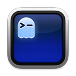

# dotfiles

My personal set of dotfiles.

### Tools

Logo | Name | Description
:---: | :--- | :---
 | [Alacritty](https://github.com/alacritty/alacritty) | Terminal emulator
 | [Claude Code](https://claude.ai/claude-code) | AI coding assistant
&nbsp; | [Fuzzel](https://codeberg.org/dnkl/fuzzel) | Wayland application launcher
 | [Ghostty](https://ghostty.org/) | Terminal emulator
 | [Git](https://git-scm.com/) | Version control
 | [Homebrew](https://brew.sh/) | macOS package manager
 | [Neovim](https://neovim.io/) | Editor / IDE
 | [Starship](https://starship.rs/) | Shell prompt
&nbsp; | [SwayNC](https://github.com/ErikReider/SwayNotificationCenter) | Wayland notification daemon
 | [Tmux](https://github.com/tmux/tmux) | Terminal multiplexer
 | [VS Code](https://code.visualstudio.com/) | Code editor
 | [Zsh](https://sourceforge.net/p/zsh/code/) | Terminal shell
